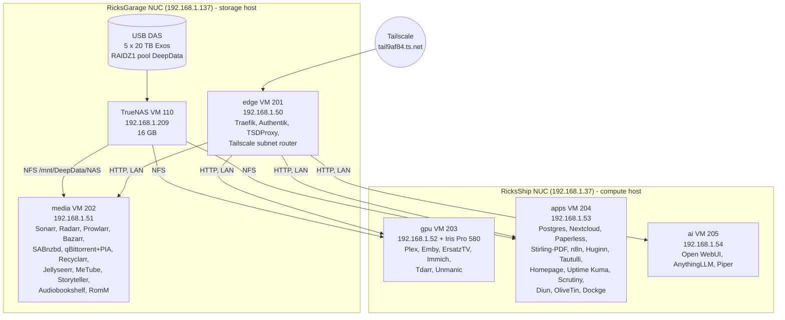

# Overview

## What the lab is

Two Intel NUCs running Proxmox form a small two-node cluster. One of them carries a five-disk USB
DAS that is handed to a TrueNAS VM, which serves one big NFS share to everything else. On top of that
sit five purpose-built Debian 12 VMs, each running one Docker Compose stack. The stacks hold about
60 containers: the Servarr media pipeline, Plex and Emby, personal cloud and document apps,
automation, monitoring, and two AI chat front ends. Everything is reachable only through Tailscale,
behind one Authentik login, except for the three things the household uses from the couch (Plex,
Emby, Requests), which stay open on the home network.

The whole thing is rebuilt from this repository: OpenTofu creates the VMs, Ansible prepares them and
deploys the stacks, and SOPS/age keeps the secrets encrypted in Git.

## The lab at a glance

## Who runs where

| VM | Host | IP | vCPU / RAM / disk | Stack contents | Needs the NAS |
| --- | --- | --- | --- | --- | --- |
| truenas (110) | RicksGarage | 192.168.1.209 | 6 (unverified) / 16 GB fixed / unchanged | TrueNAS 25.10.7, pool DeepData, NFS | is the NAS |
| edge (201) | RicksGarage | 192.168.1.50 | 2 / 3 GB / 32 GB | Traefik, Authentik (server, worker, Postgres, Redis), TSDProxy, Tailscale subnet router, Docker socket proxy, autoheal. wg-easy defined but not started | no |
| media (202) | RicksGarage | 192.168.1.51 | 4 / 6 GB (balloon floor 5 GB) / 64 GB | Sonarr, Radarr, Prowlarr, Bazarr, SABnzbd, gluetun + qBittorrent, Recyclarr, Jellyseerr, MeTube, Storyteller, Audiobookshelf, RomM + MariaDB, autoheal | yes |
| gpu (203) | RicksShip | 192.168.1.52 | 6 / 10 GB / 96 GB + iGPU passthrough | Plex, Emby, ErsatzTV, Immich (server, ML, Postgres, Valkey), Tdarr, Unmanic, autoheal | yes |
| apps (204) | RicksShip | 192.168.1.53 | 4 / 10 GB / 96 GB | Postgres (pgvector), Redis, Nextcloud (+ nginx, cron), Paperless (+ Gotenberg, Tika), Stirling-PDF, n8n, Huginn, Tautulli, Homepage, Uptime Kuma, Scrutiny (+ InfluxDB), Diun, OliveTin, Dockge, autoheal | yes (Nextcloud, Paperless, backups) |
| ai (205) | RicksShip | 192.168.1.54 | 2 / 4 GB / 32 GB | Open WebUI, AnythingLLM, Piper TTS; LangChain/CrewAI worker defined but not started | no |

The old VMs **113 Servarr** (192.168.1.14, RicksGarage) and **117 Plex** (192.168.1.15, RicksShip) were
removed on 2026-10-26 after a verified vzdump backup of each (kept on `DeepData_NFS` until about 2026-11-25).

## Service directory

All Tailscale names end in `.tail9af84.ts.net`. "SSO" means the Authentik login sits in front;
"own login" means the app's own account (these are the apps with mobile clients).

| App | Address | Login | VM | Purpose |
| --- | --- | --- | --- | --- |
| Homepage | home | SSO | apps | Dashboard listing every app with a live up/down dot |
| Authentik | auth | own (admin `akadmin`) | edge | Single sign-on in front of the admin apps |
| Plex | plex, LAN :32400 | own (plex.tv) | gpu | Media server, hardware transcoding, remote viewers through the Plex relay (no router forward) |
| Emby | emby, LAN :8096 | own (Premiere) | gpu | Second media server, Goobs's preferred one |
| Requests (Jellyseerr) | requests, LAN :5055 | own (Plex sign-in) | media | Family media requests, feeds Radarr and Sonarr |
| Sonarr / Radarr / Prowlarr / Bazarr | sonarr, radarr, prowlarr, bazarr | SSO + app login | media | TV, movies, indexers, subtitles |
| SABnzbd / qBittorrent | sabnzbd, qbittorrent | SSO + app login | media | Usenet and torrent download clients (torrents only via PIA) |
| MeTube | metube | SSO | media | yt-dlp front end, saves to Media/meTube |
| Audiobookshelf | audiobooks | own | media | Audiobooks and podcasts |
| Storyteller | storyteller | own | media | Synced ebook + audiobook reading |
| RomM | romm | SSO | media | Retro game library (Media/Games) |
| ErsatzTV | ersatztv | SSO | gpu | Custom live TV channels, appears in Plex as an HDHomeRun tuner |
| Immich (Photos) | photos | own | gpu | Photo library and phone backup |
| Tdarr / Unmanic | tdarr, unmanic | SSO | gpu | Re-encoding (Tdarr active project; Unmanic idle) |
| Nextcloud | cloud | own | apps | Files and sync |
| Paperless-ngx | paperless | SSO + own (`goobs`) | apps | Scanned documents with OCR |
| Stirling-PDF | pdf | SSO | apps | PDF tools |
| n8n | n8n | SSO + own | apps | Automation; sends the daily digest email |
| Huginn | huginn | SSO + own (`admin`) | apps | Agents and scrapers |
| Tautulli | tautulli | SSO | apps | Plex statistics (history migrated) |
| Uptime Kuma | status | SSO + own | apps | 27 monitors, instant email for critical media apps |
| Scrutiny | disks | SSO | apps | SMART health of the nine disks seen by the hosts |
| Dockge | dockge | SSO + own | apps | View stacks (read-only by policy; Git is the source of truth) |
| OliveTin | olivetin | SSO | apps | Buttons for fixed maintenance commands (not wired up yet) |
| Open WebUI | chat | SSO (auto login) | ai | Chat on Google Gemini |
| AnythingLLM | anythingllm | SSO + own | ai | Chat with your documents, Gemini + pgvector |
| Proxmox | https://192.168.1.137:8006, https://192.168.1.37:8006 | own | hosts | Hypervisor UIs (LAN or Tailscale subnet route) |
| TrueNAS | https://192.168.1.209 | own | truenas | NAS UI |

## Numbers worth knowing

- Library: 541 series in Sonarr; 3,732 movies in Radarr (3,227 with files after the 2026-10-22
  relink); Plex counts 3,368 movies and 522 shows.
- Pool: about 74 to 80% full (54.2 TB used, 18.3 TB free at the 2026-10-21 inventory).
- RAM budget: RicksGarage runs TrueNAS 16 + edge 3 + media 6 = 25 GB of 31 GiB; RicksShip runs
  gpu 10 + apps 10 + ai 4 = 24 GB of 31 GiB.
- Power draw: estimated 130 to 150 W at the wall for the whole lab, about 250 W at spin-up.
- Backups: nightly, config only, 14 days, on the NAS under `Backups/homelab/<vm>/`.
- Alerts: instant email for 8 critical media monitors; one digest at 8:00 Pacific for the rest.
