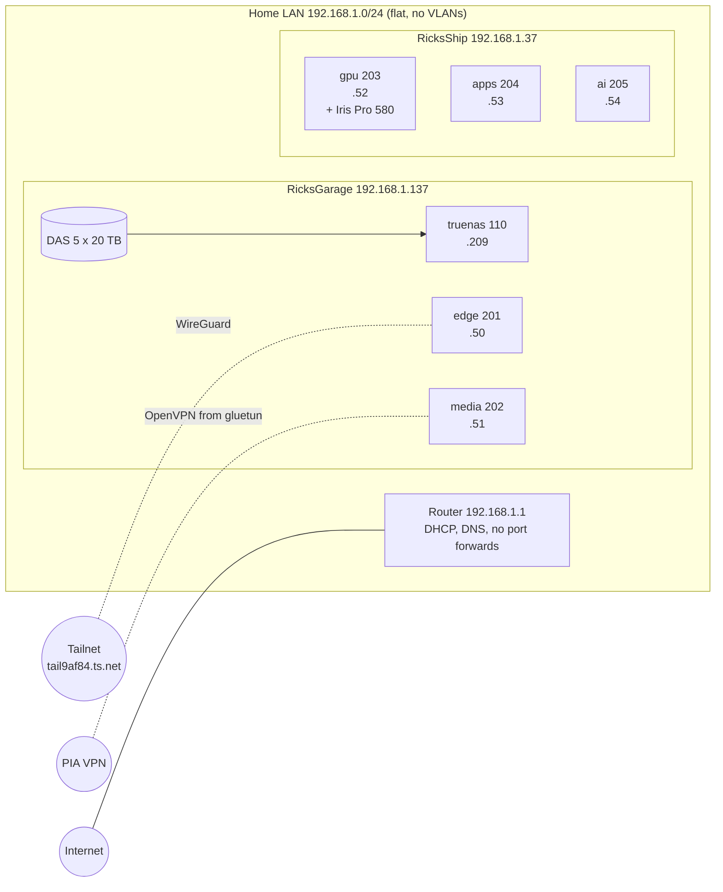
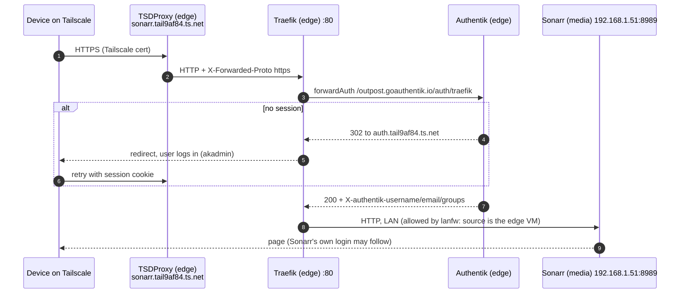
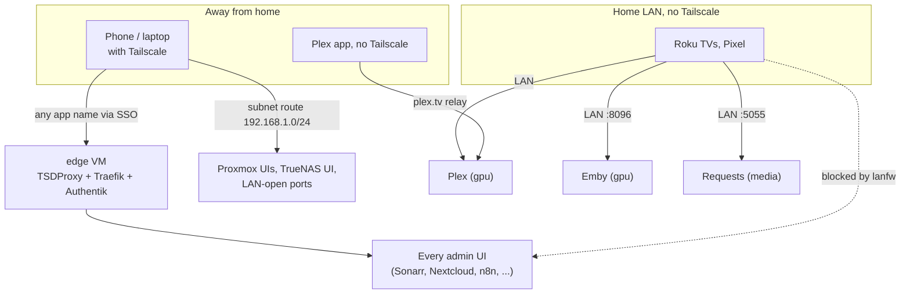
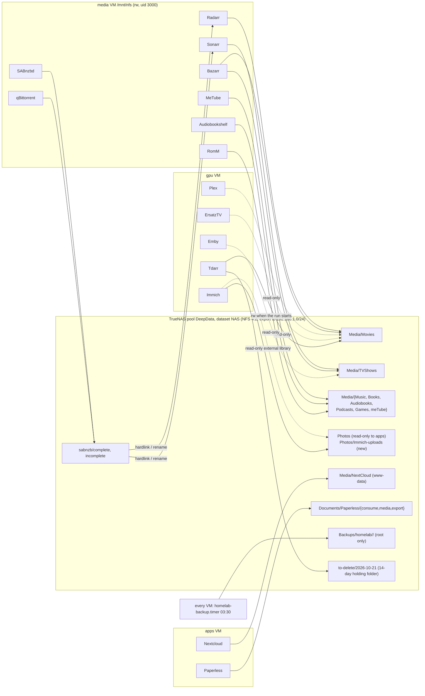
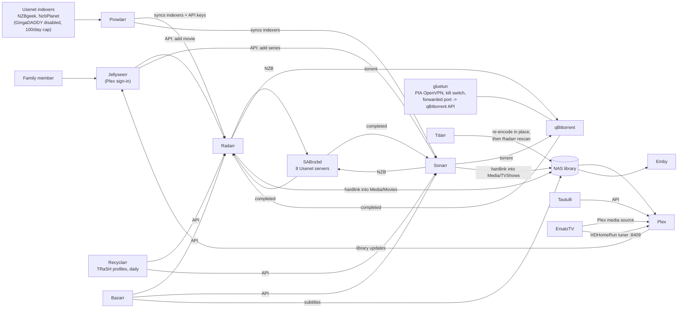
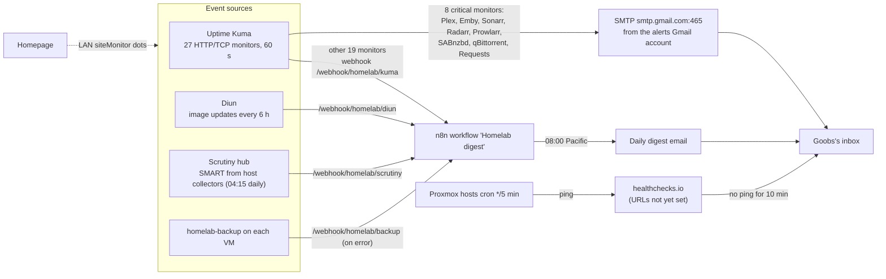
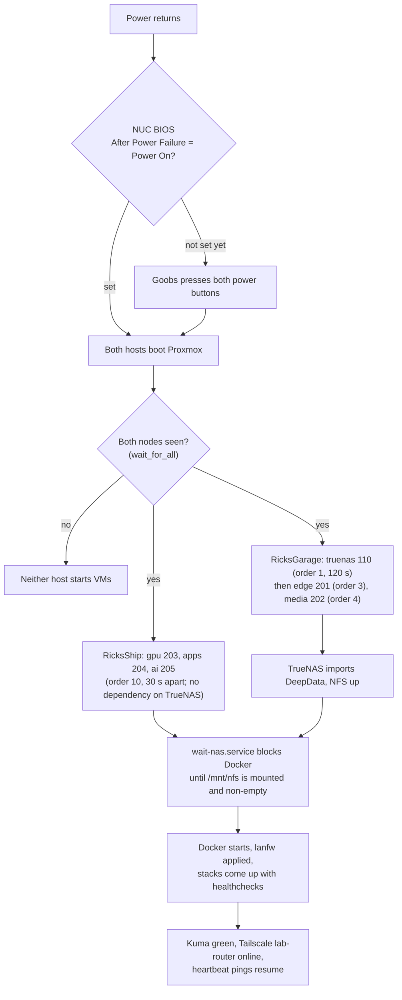
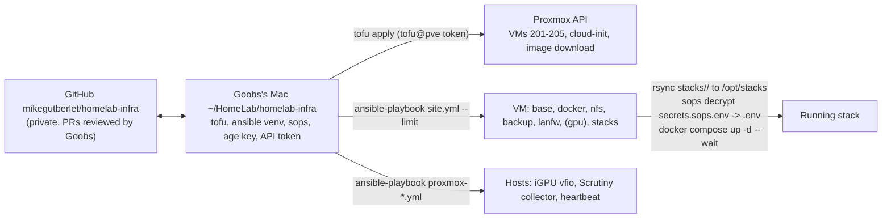

# Architecture

The lab is built in layers, and each layer has one job:

1. **Hardware**: two NUCs, one DAS. See [Hardware](02-hardware.md).
2. **Proxmox**: a two-node cluster that runs VMs. VMs, not LXC containers, because a VM gives a real
   kernel boundary between the internet-facing download clients and personal data, cleaner NFS
   mounts, and simple whole-VM backups ([D01](07-decisions.md#d01-vms-not-lxc)).
3. **TrueNAS VM**: owns the pool and serves one NFS export. It is the only stateful thing that is not
   rebuilt from code.
4. **Five Debian 12 VMs**, each created by OpenTofu from a cloud image, prepared by Ansible, and
   running exactly one Docker Compose stack. Apps are grouped by trust level and resource profile
   ([D03](07-decisions.md#d03-five-vms-split-by-trust-and-resource-profile)).
5. **Edge**: the single way in. Tailscale names, TLS, Traefik, Authentik.
6. **Operations**: backups, firewall, monitoring, alerting and self-healing, all defined in the repo.

## Physical and virtual layout

## How a request reaches an app

Every web UI is published under its own Tailscale name. TSDProxy on the edge VM registers each name
as a device on the tailnet and gets a trusted certificate for it, terminates TLS, and hands the
request to Traefik over plain HTTP inside the VM. Traefik matches the `Host` header to a route, sends
the request through the Authentik forward-auth middleware when the app is behind SSO, and proxies it
to the app's LAN address and port. The LAN firewall on every VM only lets the five lab VMs reach
those ports, so the edge VM is the only path for a phone or laptop.

Two details that caused real bugs on build day: Traefik must trust `X-Forwarded-*` headers from
TSDProxy (configured as the Docker range `172.16.0.0/12`), otherwise Authentik builds `http://` URLs
and the browser blocks them as mixed content; and apps with their own mobile clients (Plex, Emby,
Immich, Nextcloud, Jellyseerr, Audiobookshelf, Storyteller) bypass the Authentik middleware, because
their apps cannot complete a browser SSO redirect
([D06](07-decisions.md#d06-authentik-forward-auth-with-exceptions)).

Route definitions are generated: `docs/gen_routes.py` holds the single list of apps (host, port,
behind SSO or not) and writes both `stacks/edge/traefik/dynamic/routes.yml` and
`stacks/edge/tsdproxy/apps.yaml`.

## Access boundaries

The firewall rules (`ansible/roles/lanfw`) rebuild the `DOCKER-USER` iptables chain on every Docker
start: established traffic passes; the five lab VMs (.50 to .54) reach everything; a short list of
ports is open to the whole LAN (Plex is host-networked so it is open by nature; Emby 8096; Jellyseerr
5055; wg-easy 51820/udp once enabled); the Scrutiny port 8087 on the apps VM also accepts the two
Proxmox hosts; Open WebUI's port 3010 accepts only the edge VM; everything else new from the LAN is
dropped. Details in [Networking and access](04-networking-and-access.md).

## Storage and data flow

Rules that shape this picture ([Storage](05-storage.md) has the detail):

- One dataset holds downloads and library, so an import is a hardlink or rename, never a copy.
- Every VM mounts the share at the same path, `/mnt/nfs`, that the old Servarr VM used, so
  migrated database paths kept working.
- App configs and databases live on each VM's local disk under `/opt/appdata`; SQLite and Postgres
  are never put on NFS.
- Media servers and re-encoders mount media read-only until a project needs otherwise.
- Nothing on the NAS is deleted by automation; removals go to a dated holding folder first.

## The media pipeline and its APIs

## Operations flows

### Monitoring and alerting

All alerting runs on the apps VM, deliberately on the *other* host from TrueNAS and the edge VM, so a
RicksGarage failure still gets reported. The only alert that works while the whole lab is dark is the
external heartbeat.

### Self-healing layers

| What breaks | How it is caught | Automatic fix |
| --- | --- | --- |
| A container exits | Docker | `restart: unless-stopped` on every service |
| A container hangs but stays up | Compose healthcheck (HTTP or command) on most services | `autoheal` restarts a container labelled `autoheal=true` after failed checks |
| The VPN tunnel drops | gluetun healthcheck | qBittorrent shares gluetun's network namespace, so it has no network at all until gluetun reconnects (kill switch) |
| The NAS share is gone at boot | `wait-nas.service` | Docker does not start on media, gpu and apps until every NFS share is mounted and non-empty, with no timeout |
| A whole VM freezes | QEMU `i6300esb` watchdog fed by the `watchdog` daemon | Proxmox resets the VM |
| A host freezes or the power fails | External heartbeat (once URLs are set) | None; a person presses the power button. See [Power outage](operations/power-outage.md) |
| A bad image update | Nothing updates itself; Diun only notifies | Pin or revert in Git and redeploy |
| Lost config or database | Nightly backups, 14 days | Restore from `Backups/homelab/<vm>/<date>` ([Backups and restore](operations/backups-and-restore.md)) |

### Boot sequence after a cold start

## Infrastructure as code

| Layer | Tool | Where | Notes |
| --- | --- | --- | --- |
| VMs | OpenTofu, provider `bpg/proxmox` (~> 0.117) | `tofu/` | Token `tofu@pve!homelab`, secret in `~/.config/homelab/proxmox-tofu.env` on the Mac. `hostpci` and `initialization` are ignored after creation; the iGPU is attached by root with `qm set 203 --hostpci0 0000:00:02.0,pcie=1` because the token cannot set raw PCI devices |
| OS and services | ansible-core 2.15 in `~/.local/share/homelab-ansible` on the Mac | `ansible/` | Inventory `hosts.yml` lists VMs with per-host firewall and stack options; `site.yml` runs roles base, docker, nfs, backup, lanfw, gpu, stacks |
| Apps | Docker Compose, one project per VM | `stacks/<vm>/compose.yaml` | Deployed to `/opt/stacks/<vm>` on the VM; `stack_services` in the inventory limits which services start |
| Secrets | SOPS + age | `stacks/<vm>/secrets.sops.env`, `.sops.yaml` | One age key, on the Mac and on each VM for root. Decrypted to `/opt/stacks/<vm>/.env` (mode 600) at deploy time |
| Routes | `docs/gen_routes.py` | `stacks/edge/traefik/dynamic/routes.yml`, `stacks/edge/tsdproxy/apps.yaml` | Regenerate, then restart Traefik and TSDProxy (Compose does not restart on bind-mounted file changes) |
| Monitors | `docs/kuma_setup.py` | run by Goobs on the Mac | Prompts for the Kuma login and the Gmail app password, stores neither, idempotent by monitor name |
| Change log | Markdown | `~/HomeLab/changes-2026-10-21.md` on the Mac | Every host-level change with its undo step |

The repo's rules (never delete on TrueNAS, apps run as uid 3000, appdata local, secrets encrypted,
healthchecks everywhere) are listed in the top-level [README](../../README.md) and explained in
[Decision records](07-decisions.md).
