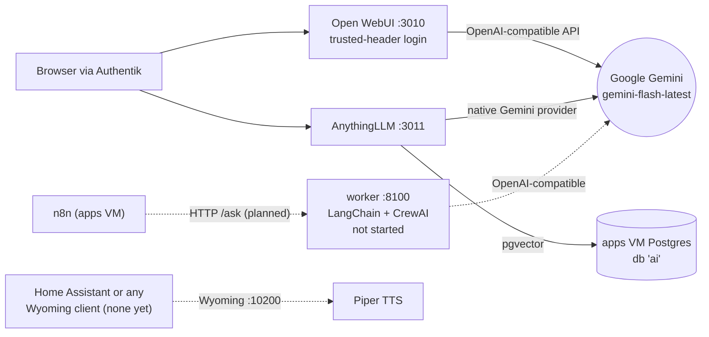

# ai VM (205, RicksShip, 192.168.1.54)

The smallest VM: 2 vCPU, 4 GB RAM, 32 GB disk. No NAS mount. It was planned around a local Ollama
model server fed by the GTX 1660 Ti eGPU; both are deferred, so the chat apps use **Google Gemini**
through Goobs's API key instead ([D13](../07-decisions.md#d13-gemini-instead-of-local-ollama-for-now)).
Stack: `stacks/ai/compose.yaml`.

## Open WebUI ("chat")

| | |
| --- | --- |
| Purpose | ChatGPT-style chat UI |
| Image / port | `ghcr.io/open-webui/open-webui:main`, 3010 (container 8080) |
| Address | https://chat.tail9af84.ts.net; after the Authentik login it signs the user in as its admin automatically |
| LLM | `OPENAI_API_BASE_URL` = Gemini's OpenAI-compatible endpoint, `OPENAI_API_KEY` = Goobs's Gemini key (both in the ai secrets), `DEFAULT_MODELS=models/gemini-flash-latest` (an alias for the current Flash; `gemini-2.5-flash` was closed to new accounts). Ollama API disabled |
| Security | `WEBUI_AUTH_TRUSTED_EMAIL_HEADER=X-authentik-email` means anyone who can reach port 3010 could impersonate any user by setting that header. So the LAN firewall allows 3010 **only from the edge VM** (`edge_only_ports` on the ai host), and the app stayed off until that rule existed. Consequence: no Homepage status dot and no Kuma monitor can check it from the apps VM |
| Data | `/opt/appdata/open-webui` |

## AnythingLLM

| | |
| --- | --- |
| Purpose | Chat with your own documents (RAG) |
| Image / port | `mintplexlabs/anythingllm:latest`, 3011 (container 3001), `SYS_ADMIN` capability (the image needs it for its browser-based scraping) |
| Address | https://anythingllm.tail9af84.ts.net (SSO) plus its own password set in the first-run wizard (Goobs was testing it on 2026-10-21; completion `(unverified)`) |
| LLM | Native Gemini provider, `GEMINI_LLM_MODEL_PREF=gemini-flash-latest`; vectors in the apps VM's Postgres (`pgvector`, database `ai`, user `ai`) over the LAN |
| Data | `/opt/appdata/anythingllm`, owned by uid 1000 (the image's user) |

## Piper

`rhasspy/wyoming-piper:latest`, voice `en_US-lessac-medium`, Wyoming protocol on 10200. Text to
speech for anything that speaks Wyoming (Home Assistant is the usual client; none exists in the lab
yet). Kuma checks the TCP port. Data in `/opt/appdata/piper`.

## worker (LangChain + CrewAI)

Built from `stacks/ai/worker/` (FastAPI, `langchain_openai.ChatOpenAI` against the same Gemini
endpoint, pgvector URL available). Endpoints `GET /health` and `POST /ask {"text": ...}` on port 8100.
Meant to be called from n8n for agent-style jobs. **Not started** (not in `stack_services`); it covers
the "LangChain" and "CrewAI" items from the original list, which are libraries rather than services.

## Where the AI key lives

Only on the Mac (`~/.config/homelab/ai-apikey`, stored encrypted at rest by Goobs's own setup) and
encrypted in `stacks/ai/secrets.sops.env` as `LLM_API_KEY`. The key format is Google's non-`AIza`
style with a dot in it; it was verified against the Gemini API before use.
