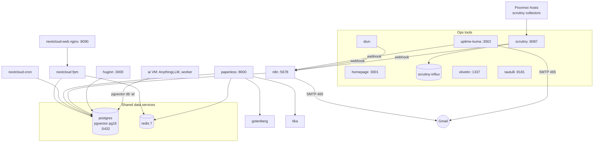

# apps VM (204, RicksShip, 192.168.1.53)

Personal cloud, documents, automation and all the ops tools. 4 vCPU, 10 GB RAM, 96 GB disk on
`RicksShipXFS`. Monitoring lives here, on the other host from TrueNAS and the edge VM, so it can still
alert when RicksGarage is down. Mounts the NAS for Nextcloud, Paperless and backups. Prometheus, Grafana and their exporters
also run here; they have their own page, [monitoring](monitoring.md). Stack:
`stacks/apps/compose.yaml`, 20 containers.

## Postgres and Redis

| | |
| --- | --- |
| Image | `pgvector/pgvector:pg16`, port 5432 published (LAN firewall limits it to the lab VMs; the ai VM uses it) |
| Databases | One database and user each for `nextcloud`, `paperless`, `n8n`, `huginn` and `ai` (pgvector), created by `postgres/init.sh` on first start from the per-app passwords in the secrets |
| Data | `/opt/appdata/postgres`; dumped nightly with `pg_dumpall` |
| Redis | `redis:7-alpine`, shared by Nextcloud (cache/locking) and Paperless (queue, db 1) |
| Health | `pg_isready`, `redis-cli ping`; dependants wait for healthy |

## Nextcloud ("cloud")

| | |
| --- | --- |
| Images | `nextcloud:31-fpm` (app), `nginx:1.27-alpine` as `nextcloud-web` on 8090 (internal web server only; Traefik is the reverse proxy), a second `nextcloud:31-fpm` running `/cron.sh` |
| Address | https://cloud.tail9af84.ts.net (own login, no Authentik so sync clients work); admin created by Goobs 2026-10-21 |
| Data | `/opt/appdata/nextcloud/html` (code, apps) and **`/mnt/nfs/Media/NextCloud`** as the data directory (owned 33:33, 0770; Nextcloud refuses a data dir other users can read). Files are only readable through Nextcloud, not by browsing the share |
| Settings | `NEXTCLOUD_TRUSTED_DOMAINS` = cloud name and 192.168.1.53 (the LAN IP was added with `occ config:system:set` so Kuma and Homepage can check it); `TRUSTED_PROXIES=192.168.1.50`; `OVERWRITEPROTOCOL=https` |
| Backup | Postgres dump nightly; `/opt/appdata/nextcloud/html` is excluded from the tar (regenerable); user files on the NAS are not backed up by the lab (media/data policy) |
| Health | Kuma `GET /status.php` |

## Paperless-ngx

| | |
| --- | --- |
| Images | `ghcr.io/paperless-ngx/paperless-ngx:2.20` (no floating `:2` tag), `gotenberg/gotenberg:8` and `apache/tika:latest` for Office/HTML conversion |
| Port / address | 8000, https://paperless.tail9af84.ts.net (SSO) plus superuser `goobs` (password generated on the Mac at `~/.config/homelab/paperless-admin`) |
| Data | `/opt/appdata/paperless/data`; documents in **`/mnt/nfs/Documents/Paperless/{media,consume,export}`** (new add-only folders, 3000:3000). Drop a scan into `consume` and it gets OCR'd |
| Settings | `USERMAP_UID/GID` 3000, Tika on, `PAPERLESS_URL` set to the ts.net name, secret key in the secrets |
| Health | Kuma `GET /` |

## Stirling-PDF

`stirlingtools/stirling-pdf:latest`, port 8070, https://pdf.tail9af84.ts.net (SSO),
`DOCKER_ENABLE_SECURITY=false` because Authentik handles login. Config in `/opt/appdata/stirling-pdf`.

## n8n

| | |
| --- | --- |
| Purpose | Automation. Today it runs the **Homelab digest** workflow and is the webhook sink for all non-critical events |
| Image / port | `docker.n8n.io/n8nio/n8n:latest`, 5678 |
| Address | https://n8n.tail9af84.ts.net (SSO) plus the owner account Goobs created |
| Data | `/opt/appdata/n8n` owned by uid 1000 (the image's `node` user, which n8n needs); Postgres database `n8n`; `N8N_ENCRYPTION_KEY` in the secrets, so losing the secrets file means losing stored credentials |
| Workflow | `stacks/apps/n8n/homelab-digest.workflow.json`: webhook nodes at fixed paths `/webhook/homelab/{diun,kuma,scrutiny,backup,other}` store events in workflow static data; a schedule node at 08:00 Pacific builds one email grouped by source ("App status (non-critical)", "Image updates available", "Disk health", "Backups") and clears the store; an empty day sends a "nothing to report" line. Activated through the API on 2026-10-21 |
| Mail | SMTP credential "Gmail SMTP" typed in by Goobs: `smtp.gmail.com`, port 465, SSL on, user = the alerts Gmail account. Port 587 failed with "wrong version number" |
| API key | On the Mac at `~/.config/homelab/n8n-apikey`, used to activate the workflow and for future automation |
| Health | Kuma `GET /healthz` |

## Sysadmin investigator

`homelab/sysadmin-investigator:2`, built from `stacks/apps/sysadmin-investigator/` (Python and the
Claude Agent SDK), port 3006 on the stack's network only (n8n calls it; nothing is published).
The sysadmin chat's `investigate` tool and the alert auto-investigation, on Claude Sonnet 5.5 with
a $2 a day cap. Settings in `/opt/appdata/sysadmin-investigator/investigator.env` (written by
`docs/sysadmin_deploy.py`), state in `data/`, a read-only copy of this repository in `repo/`.
See [sysadmin: the investigator](../operations/sysadmin.md#the-investigator-hard-questions).

## TrueNAS bridge

`homelab/truenas-bridge:1`, built from `stacks/apps/truenas-bridge/`: the sysadmin workflow's
15-minute NAS reads and the investigator's `truenas` tool ask `http://truenas-bridge:8080/<method>`
(read-only JSON-RPC methods such as `pool.query`, `alert.list`), and it talks to the NAS over the
WebSocket API with the same key Homepage uses. TrueNAS deprecated the REST API in 25.04 (removed
in 26) and raises a RESTAPIUsage alert on every use; Homepage's widget uses `version: 2` for the
same reason (2026-10-28).

## Huginn

`ghcr.io/huginn/huginn:latest`, port 3000, https://huginn.tail9af84.ts.net (SSO). Postgres database
`huginn` (created by init.sh; `DO_NOT_CREATE_DATABASE=true` because the app user cannot create
databases, which was the cause of the first "Bad Gateway"). The first-start seed created admin
`admin` with a generated password saved on the Mac (`~/.config/homelab/huginn-admin`); there was never a
default `admin/password` login. Goobs logged in on 2026-10-21; whether the password was changed
afterwards is `(unverified)`. No agents configured yet.

## Tautulli

`lscr.io/linuxserver/tautulli:latest`, port 8181, https://tautulli.tail9af84.ts.net (SSO). Plex
statistics, moved from the snap on the old Plex VM with its full history and pointed at the new Plex.
Config in `/opt/appdata/tautulli`. Health `GET /status`.

## Homepage

`ghcr.io/gethomepage/homepage:v1`, port 3001, https://home.tail9af84.ts.net (SSO).
`stacks/apps/homepage/services.yaml` lists every app on the five VMs in six groups (Watch, Downloads,
Apps, AI, Lab, Hosts) with Tailscale links and a `siteMonitor` on the LAN health URL (allowed by lanfw
because the check comes from a lab VM). Open WebUI has no status dot because only the edge VM may
reach its port. Widgets (queues, streams, counts, host load) exist for the arr apps, SABnzbd,
qBittorrent, Jellyseerr, Plex, Emby, Tautulli, Immich, Audiobookshelf, RomM, Nextcloud, Paperless,
Tdarr, Uptime Kuma, Scrutiny, both Proxmox hosts and TrueNAS. Their keys live in the apps stack
secrets as `HOMEPAGE_*` and reach the container as `HOMEPAGE_VAR_*` (compose.yaml); an empty key only
breaks that one tile. `settings.yaml` holds the layout and `widgets.yaml` the top bar.
`HOMEPAGE_ALLOWED_HOSTS` is the ts.net name; `HOMEPAGE_VAR_TAILNET` feeds the links.

## Uptime Kuma ("status")

| | |
| --- | --- |
| Image / port | `louislam/uptime-kuma:2` (1.x was unsupported; v2 migrated the v1 database on first start), 3002 |
| Address | https://status.tail9af84.ts.net (SSO) plus Kuma's own admin account (Goobs's) |
| Monitors | 27, created by `docs/kuma_setup.py` (run by Goobs; it opens an SSH tunnel to the apps VM, prompts for the Kuma login and the Gmail app password, stores neither, and skips monitors that already exist). 60 s interval. HTTP checks against LAN health URLs; TCP checks for Traefik and Piper; HTTPS for TrueNAS and both Proxmox UIs |
| Notifications | "Email now (critical)" (SMTP 465) attached to Plex, Emby, Sonarr, Radarr, Prowlarr, SABnzbd, qBittorrent (via PIA), Requests. Everything else posts to `http://n8n:5678/webhook/homelab/kuma` for the digest |
| Gaps | No monitors yet for ErsatzTV, Immich, Tdarr, Unmanic, Open WebUI (port locked), wg-easy; the script's list needs those added and a re-run |
| Data | `/opt/appdata/uptime-kuma` (SQLite, backed up by online copy) |

## Scrutiny ("disks")

`ghcr.io/analogj/scrutiny:v0.9.5-web` hub on 8087 with `influxdb:2.7`, https://disks.tail9af84.ts.net
(SSO). The collectors run **on the Proxmox hosts** (`ansible/playbooks/proxmox-scrutiny.yml`, same
v0.9.5 binary, daily cron at 04:15), because TrueNAS only sees virtual disks. Nine disks are shown;
the 20 TB drive with serial `ZVTAM9MF` has a few USB command timeouts and is being watched. Warnings
go to the digest via the shoutrrr generic webhook. Known quirk: crashed once at boot after the power
cut because InfluxDB was a few seconds late; it recovered by itself, and a `depends_on` with a
healthcheck is the planned fix. Config `/opt/appdata/scrutiny/config`; InfluxDB data excluded from
backups.

## Diun

`crazymax/diun:4`, `serve` mode, watches every container on this VM's Docker socket (read-only) every
6 hours (`0 */6 * * *`), `WATCHBYDEFAULT=true`, and posts new image versions to
`http://n8n:5678/webhook/homelab/diun`. Since 2026-10-26 the other four VMs run the same Diun (posting to
`http://192.168.1.53:5678/webhook/homelab/diun`), and the sysadmin updates the hosts.yml `auto_update`
services itself; see [sysadmin](../operations/sysadmin.md).

## OliveTin

`jamesread/olivetin:latest`, port 1337, https://olivetin.tail9af84.ts.net (SSO). Buttons for a fixed
list of commands in `stacks/apps/olivetin/config.yaml`: a jdupes duplicate report over `/mnt/nfs/Media`
(read-only, via SSH to the media VM) and `zpool status DeepData` (via SSH to TrueNAS). **Not wired
up**: the SSH key and restricted users do not exist yet, by design, until Goobs wants them.

## Dockge (removed 2026-10-27)

Dockge ran here until 2026-10-27. It was removed because it held the Docker socket with write access
(root on this VM from a web page) and invited edits that bypass the repo. Container logs: Grafana or
`sudo docker compose -f /opt/stacks/apps/compose.yaml logs <service>` on the VM.

## Backups on this VM

Nightly: `pg_dumpall` of the shared Postgres, SQLite copies (Kuma, Tautulli, Homepage), and
the appdata tar. Excluded: `nextcloud/html`, `scrutiny/influxdb`, caches and logs.
