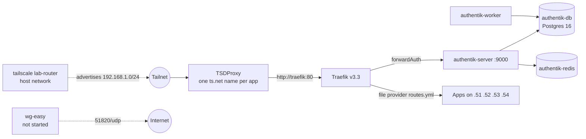

# edge VM (201, RicksGarage, 192.168.1.50)

The only way into any app. 2 vCPU, 3 GB RAM, 32 GB disk on `local-lvm`, starts third after TrueNAS.
It does **not** mount the NAS. Stack: `stacks/edge/compose.yaml`. Two Docker networks: `authentik` (internal, Authentik and its databases),
and `proxy` (Traefik, Authentik server, TSDProxy, wg-easy).

## Traefik

| | |
| --- | --- |
| Purpose | Reverse proxy for every web UI; applies the Authentik middleware |
| Image | `traefik:v3.3` |
| Listens | `:80` on the VM (only TSDProxy and the lab VMs can reach it) |
| Config | Static flags in the compose command; dynamic routes in `traefik/dynamic/routes.yml` (file provider, watched); no Docker provider (removed 2026-10-22: it errored every few seconds against the newer daemon API and nothing used it) |
| Key settings | `entrypoints.web.forwardedHeaders.trustedIPs=172.16.0.0/12` so TSDProxy's `X-Forwarded-Proto: https` is believed; `--ping` on the `web` entrypoint, so `http://192.168.1.50/ping` serves the healthcheck, Homepage and Kuma; dashboard API on (not routed externally); access log on |
| Health | `traefik healthcheck --ping` every 30 s |
| Talks to | Authentik outpost (forward auth), every app's LAN port |
| Notes | Traefik does not terminate TLS; TSDProxy does. Changing `routes.yml` through a redeploy does not restart Traefik: restart it by hand after route changes |

## Authentik

| | |
| --- | --- |
| Purpose | Single sign-on for the admin apps; one login for the lab |
| Images | `ghcr.io/goauthentik/server:2025.8` (server and worker), `postgres:16-alpine`, `redis:7-alpine` |
| Address | https://auth.tail9af84.ts.net (no middleware in front of itself) |
| Login | `akadmin`, password set by Goobs on 2026-10-21 through a one-time recovery link (the initial-setup flow refused because a bootstrap password already existed) |
| Data | `/opt/appdata/authentik/db` (Postgres). Secrets: `AUTHENTIK_SECRET_KEY`, `AUTHENTIK_DB_PASSWORD` in the edge secrets |
| Integration | Embedded outpost used by Traefik's `forwardAuth` middleware; response headers `X-authentik-username`, `X-authentik-groups`, `X-authentik-email`. Set up by `stacks/edge/authentik/setup_forward_auth.py` |
| Health | Postgres and Redis have healthchecks; the server depends on them |
| State | Working for all SSO apps. Only one user. No 2FA stage configured `(unverified)`. Users cannot change their own email (Authentik default); the admin edits it under Directory > Users |

## TSDProxy

| | |
| --- | --- |
| Purpose | Gives each app its own `<app>.tail9af84.ts.net` name with a Tailscale-issued certificate, and forwards to Traefik |
| Image | `almeidapaulopt/tsdproxy:1` (1.4.7 at build time) |
| Config | `tsdproxy/tsdproxy.yaml` (provider `default` with `authKeyFile: /run/secrets/tsdproxy_authkey`) and `tsdproxy/apps.yaml` (generated list; every entry is `url: http://traefik:80`) |
| Data | `/opt/appdata/tsdproxy` holds the Tailscale state for each registered name |
| Quirks learned | 1.4 ignores the `TSDPROXY_AUTHKEY` environment variable once a provider is defined, so the key arrives as a Compose secret file. List entries take a single `url`, not a `ports:` block. The auth key must be reusable: a single-use key was consumed by the subnet router on the first night and the names could not register until Goobs made a new one |
| State | About 31 names registered. Restart it after `apps.yaml` changes |

## Tailscale subnet router

| | |
| --- | --- |
| Purpose | Makes 192.168.1.0/24 reachable from every Tailscale device (Proxmox UIs, TrueNAS, LAN ports) |
| Image | `tailscale/tailscale:stable`, hostname `lab-router`, host network, `NET_ADMIN`, `/dev/net/tun` |
| Settings | `TS_ROUTES=192.168.1.0/24`, kernel networking (`TS_USERSPACE=false`); IP forwarding is enabled by the base role on the edge VM only |
| Data | `/opt/appdata/tailscale` (node state) |
| State | Route auto-approved by the tailnet ACL `autoApprovers` rule. Replaced the old, long-offline routers from the previous setup |

## wg-easy

| | |
| --- | --- |
| Purpose | Fallback VPN into the lab if Tailscale is ever down; keys only, one UDP port |
| Image | `ghcr.io/wg-easy/wg-easy:15`; ports 51820/udp (WireGuard) and 51821/tcp (admin UI, routed as `wireguard.tail9af84.ts.net` behind Authentik) |
| State | **Defined but not started** (left out of `stack_services`). Its first-run page sets the admin password and would be open on the LAN until then, so it is a step to do together with Goobs. Also needs a router forward of 51820/udp to .50 to be useful from outside. Goobs still has to decide whether to keep it ([Open items](../08-open-items.md)) |

## Resource notes

RicksGarage is the tight host (TrueNAS 16 + edge 3 + media 6 GB of 31 GiB). The edge VM's 3 GB is
enough for Authentik's two Python processes plus Traefik and TSDProxy; watch it if Authentik grows.
