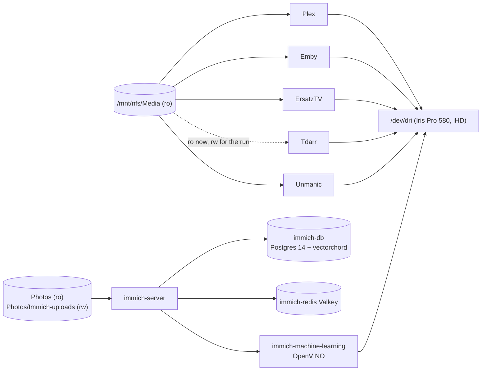

# gpu VM (203, RicksShip, 192.168.1.52)

The VM that owns the Intel Iris Pro 580. 6 vCPU, 10 GB RAM, 96 GB disk on `RicksShipXFS`. The iGPU
(PCI `0000:00:02.0`, vendor:device `8086:193b`) is bound to `vfio-pci` on the host by
`ansible/playbooks/proxmox-igpu.yml` and attached to the VM by root with
`qm set 203 --hostpci0 0000:00:02.0,pcie=1` (OpenTofu ignores `hostpci` because the `tofu@pve`
token cannot set raw PCI devices). Inside the VM the `gpu` role installs the non-free
`intel-media-va-driver-non-free` (iHD) and adds `storage` to the `render` and `video` groups. Every
media container gets `/dev/dri`. The host's console goes dark at boot because the GPU no longer
belongs to it; that is expected.

Mounts the NAS at `/mnt/nfs`; `Media` is read-only to every container except Tdarr, which has
had it read-write (plus the `to-delete` holding folder) since PR #8 on 2026-10-22 for the
re-encoding run. Stack: `stacks/gpu/compose.yaml`. The Skylake iGPU can hardware-decode H.264
and 8-bit HEVC and encode both; it cannot decode 10-bit HEVC or AV1, which fall back to CPU.

## Plex

| | |
| --- | --- |
| Purpose | Media server. Same claimed server identity ("Tahoe") and watch history as the old Plex VM |
| Image | `lscr.io/linuxserver/plex:latest`, `VERSION=docker`, `network_mode: host` (port 32400 plus discovery) |
| Address | https://plex.tail9af84.ts.net/web (no Authentik), LAN http://192.168.1.52:32400, remote via router forward 6996 |
| Remote Access | Must stay **on** (Settings > Remote Access, manual port 6996). When it is off, plex.tv refuses the server's check-ins and after a few days stops listing it, and then the Roku and other apps cannot find Plex at all, at home too. That happened 2026-10-25: it went off during the 2026-10-21 power cut. Since 2026-10-25 the router sits behind carrier NAT (its WAN address is 100.82.x), so direct connections from outside fail and remote apps use the slow Plex relay; see [Open items](../08-open-items.md) |
| Data | `/opt/appdata/plex` (about 40 GB copied from the snap on the old VM on 2026-10-21, old copy left in place for rollback), transcodes in `/opt/appdata/transcode/plex` |
| Libraries | Movies (3,368), TV Shows (522), plus two smaller ones (XRated, Other Videos); 4 libraries total, all under `/mnt/nfs/Media`, mounted read-only |
| Hardware transcoding | Quick Sync through VA-API, verified (`h264_vaapi`) on 2026-10-21 |
| Settings changed | "Empty trash automatically after every scan" turned **off** on 2026-10-22, because a scan during a window where the NAS is unmounted would have emptied the library |
| Live TV | ErsatzTV added as an HDHomeRun tuner at `http://192.168.1.52:8409` |
| Home rows | Curated rows from Kometa (daily 05:00), see [home rows](../../home-rows.md) |
| Integrations | Tautulli (apps VM), Jellyseerr sign-in and availability, Radarr/Sonarr notifications, ErsatzTV media source |
| Health | `GET /identity` every 60 s; critical Kuma monitor (instant email). Neither sees plex.tv: the sysadmin agent checks Remote Access, the plex.tv sign-in and whether plex.tv lists the server every 15 min, and switches Remote Access back on (`plex-remote-on`, see [sysadmin](../operations/sysadmin.md)) |
| Why still Plex | Goobs prefers Emby but calls Plex "a necessary evil for now" (2026-10-21); both run side by side ([D09](../07-decisions.md#d09-plex-and-emby-side-by-side)) |

## Emby

Curated home rows come from the Home Screen Companion plugin, fed by the home-rows container (daily 07:00); see [home rows](../../home-rows.md).

| | |
| --- | --- |
| Purpose | Second media server, Goobs's preferred one |
| Image / port | `lscr.io/linuxserver/emby:latest`, 8096, **open to the whole LAN** |
| Address | https://emby.tail9af84.ts.net (no Authentik), LAN http://192.168.1.52:8096 |
| Data | `/opt/appdata/emby` (fresh install 2026-10-21; admin and libraries Movies + TVShows set up by Goobs), transcodes in `/opt/appdata/transcode/emby` |
| Premiere | Key added by Goobs 2026-10-21; hardware transcoding (`h264_qsv`, decode and encode for H.264 and HEVC) verified from a 720p/2 Mbps test play |
| Health | `GET /emby/System/Ping`; critical Kuma monitor |

## ErsatzTV

| | |
| --- | --- |
| Purpose | Custom 24/7 "live TV" channels built from the library, exposed as an HDHomeRun tuner |
| Image / port | `jasongdove/ersatztv:latest-vaapi` (v25.2.0 at setup), 8409 |
| Address | https://ersatztv.tail9af84.ts.net (SSO) |
| Data | `/opt/appdata/ersatztv` |
| Setup (2026-10-22, "ErsatzTV channel curation" thread) | Media source: the Plex server, syncing only the Movies and TV Shows libraries (never Courses or adult libraries). FFmpeg profile VAAPI on `/dev/dri/renderD128`, raised from 2 to 8 Mbps, AAC stereo for Roku/Android. Goobs picked all 11 proposed channels: Cartoon Network, Family Movies, Sitcoms, Action, Franchise Marathons, Sci-Fi, Fright Night, Throwback, Crime & Procedurals, Discovery, Reality. Build was under way at the time of writing; inventory files in `~/HomeLab/ersatztv/` on the Mac |
| Watching | Plex > Live TV & DVR with tuner `http://192.168.1.52:8409` |
| Health | No Compose healthcheck; no Kuma monitor yet |

## Immich ("Photos")

| | |
| --- | --- |
| Purpose | Google Photos-style library and phone backup |
| Images | `immich-server` and `immich-machine-learning` (`-openvino` variant, 1 worker, model TTL 300 s, 3 GB memory limit), `valkey/valkey:8-alpine`, `ghcr.io/immich-app/postgres:14-vectorchord0.4.3-pgvectors0.2.0` (the exact combination from Immich v3.3.5's official compose); `IMMICH_VERSION` in the secrets (`release`) |
| Port / address | 2283, https://photos.tail9af84.ts.net (own login, no Authentik so the phone app works) |
| Data | Uploads to `/mnt/nfs/Photos/Immich-uploads` (new folder, 3000:3000); existing `/mnt/nfs/Photos` mounted **read-only** at `/mnt/photos` to be added as an external library; DB in `/opt/appdata/immich/db`; ML model cache in `/opt/appdata/immich/model-cache` |
| Runs as | 3000:3000 plus groups 44 and 104 for `/dev/dri` |
| Own Postgres | Needs a pinned vector extension, so it does not share the apps VM's Postgres |
| State | Running since 2026-10-21 22:37 UTC. Whether Goobs has created the admin account and added the external library is `(unverified)`; first-run steps are in `homelab/gpu-apps-first-run.md`. `/opt/appdata/immich` is **excluded from the nightly backup** (size); its database dump is included because the backup script dumps every Postgres container |

## Tdarr

| | |
| --- | --- |
| Purpose | Re-encode H.264 movies to 8-bit HEVC with Quick Sync; the active library-shrinking project |
| Image | `ghcr.io/haveagitgat/tdarr:latest` (5.8 GB), internal node `gpu-vm`, ports 8265 (UI) and 8266 (server) |
| Address | https://tdarr.tail9af84.ts.net (SSO) |
| Data | `/opt/appdata/tdarr/{server,configs,logs}`; transcode cache `/opt/appdata/transcode/tdarr` on local disk, never NFS |
| Media mount | `/mnt/nfs/Media` **read-write** and `/mnt/nfs/to-delete` mounted for the holding folder since PR #8 (merged 2026-10-22). Tdarr replaces files in place, so this is the one container besides Radarr/Sonarr that can change the library. The full run is on hold behind the Radarr folder-rename task |
| Settings decided | See [Media library projects](../06-media-library.md#tdarr-settings) |
| Health | No Compose healthcheck; no Kuma monitor yet |

## Unmanic

`josh5/unmanic:latest`, port 8888, https://unmanic.tail9af84.ts.net (SSO), `/dev/dri`, library at
`/library` = `/mnt/nfs/Media` **read-only**, cache `/opt/appdata/transcode/unmanic`. Installed because
Goobs asked to keep it alongside Tdarr, deliberately idle with no library configured. If it is ever
used, it gets its own folders and an off-hours schedule so it never fights Tdarr for the iGPU or the
same files.

## Resource notes

10 GB for Plex, Emby, ErsatzTV, Immich (ML capped at 3 GB), Tdarr and Unmanic; about 5.7 GB free
after the four extra apps started. Tdarr runs one worker at low priority and pauses 17:00 to 23:00
Pacific so evening streaming keeps the GPU.
