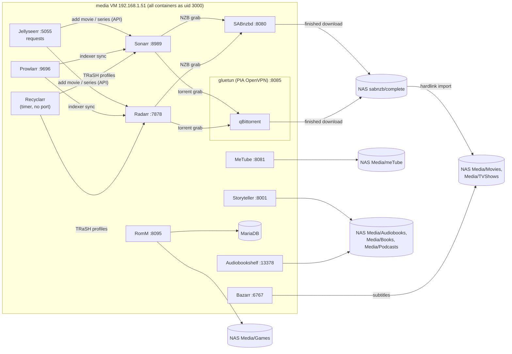

# media VM (202, RicksGarage, 192.168.1.51)

The download and library-management VM. 4 vCPU, 6 GB RAM with a 5 GB balloon floor (3 GB starved it
on 2026-10-21: the apps alone use about 3 GB plus page cache, and there is no swap), 64 GB disk,
starts fourth. Sits on the same host as TrueNAS so library I/O stays on the virtual bridge. Mounts the
whole NAS export read-write at `/mnt/nfs`, the same path the old Servarr VM used. Everything runs as
`storage` 3000 with `UMASK=002`. Stack: `stacks/media/compose.yaml`.

All of these apps were **migrated** from the old Servarr VM (192.168.1.14, bare-metal installs on
Ubuntu 22.04 Desktop) on 2026-10-21 17:05 to 17:25 UTC using each app's own backup/restore or a
config copy, following the Servarr migration plan (project file `homelab/servarr-migration-plan.md`). The old VM's configs were saved to `/root/migration-20261021` on that VM
before it was shut down; the VM was removed on 2026-10-26 and that folder now lives only in its vzdump
backup (see [TrueNAS and hosts](truenas-and-hosts.md#the-old-vms-removed-2026-10-26)).

Published ports are reachable from the lab VMs only, except Jellyseerr 5055, which is open to the LAN.
The qBittorrent WebUI is published by the gluetun container (shared network namespace).

## Sonarr

| | |
| --- | --- |
| Purpose | TV series management: 541 series, monitored lists, quality profiles, download history |
| Image / port | `lscr.io/linuxserver/sonarr:latest` (restored from a 4.0.20 backup), 8989 |
| Address | https://sonarr.tail9af84.ts.net (SSO), plus Sonarr's own forms login set by Goobs |
| Data | `/opt/appdata/sonarr`; root folder `/mnt/nfs/Media/TVShows` |
| Integrations | Prowlarr (indexers synced in), SABnzbd and qBittorrent (download clients), Bazarr, Jellyseerr, Recyclarr, Plex/Emby notifications `(unverified)` |
| Profile | 538 of 541 series use "Anything Not Terrible " (with a trailing space); Recyclarr applies the TRaSH **WEB-1080p** template to it, so it tops out at 1080p. 7,652 episodes became upgrade-eligible; upgrades arrive through RSS only, never a mass search. Since 2026-10-23 a 1080p episode is final (see *Smaller files* under Recyclarr) |
| Settings worth knowing | Hardlinks on ("use hardlinks instead of copy"); "Unmonitor deleted episodes" off (checked after the outage) |
| Health | `GET /ping` every 30 s |

## Radarr

| | |
| --- | --- |
| Purpose | Movie management: 3,732 movies, 3,227 with files after the relink project |
| Image / port | `lscr.io/linuxserver/radarr:latest` (restored from a 6.4.4 backup), 7878 |
| Address | https://radarr.tail9af84.ts.net (SSO) plus its own login |
| Data | `/opt/appdata/radarr`; root folder `/mnt/nfs/Media/Movies`; recycling bin pointed at `/mnt/nfs/to-delete/2026-10-21/radarr-recycle`, auto-cleanup off |
| Profile | "Anything Not terrible" follows the TRaSH **HD Bluray + WEB** template (1080p cap). The TRaSH "x265 (HD)" custom format is scored 0 instead of -10000 (PR #6) so Radarr never tries to replace Tdarr's HEVC re-encodes (+500 since 2026-10-23). 774 movies became cutoff-unmet, RSS-only upgrades, mostly WEB-DL to 10-15 GB Bluray; since 2026-10-23 a 1080p movie is final (see *Smaller files* under Recyclarr) |
| Settings | Hardlinks on; "Unmonitor deleted movies" off; H.265 penalty off |
| Project state | See [Media library projects](../06-media-library.md): 660 of 850 lost movies relinked, duplicate sorting under way, a folder-rename task (337 folders "Title2026" to "Title (2026)") queued by another thread |
| Health | `GET /ping` |

## Prowlarr

| | |
| --- | --- |
| Purpose | One place for indexers; pushes them and their API keys to Sonarr and Radarr |
| Image / port | `lscr.io/linuxserver/prowlarr:latest` (restored from 2.6.5), 9696 |
| Address | https://prowlarr.tail9af84.ts.net (SSO) plus its own login |
| Indexers | **NZBgeek** and **NzbPlanet** active (priority 25). **GingaDADDY** disabled with settings kept, grab limit 100/day, query limit 500/day, priority 50. It capped the account at 500 RSS downloads/day on 2026-10-21 after a retry storm caused by the old failed imports (about 3,300 dead grabs a day). A scheduled task re-enables it around 2026-10-22 05:45 UTC; if it is still capped, Goobs should email them |
| Data | `/opt/appdata/prowlarr` |

## Bazarr

| | |
| --- | --- |
| Purpose | Subtitles for Sonarr's and Radarr's libraries |
| Image / port | `lscr.io/linuxserver/bazarr:latest` (config copied from 1.6.2), 6767 |
| Address | https://bazarr.tail9af84.ts.net (SSO) |
| Data | `/opt/appdata/bazarr`; media at `/mnt/nfs` |
| Languages | Profile **English + Japanese** on every movie and series (Goobs's choice, 2026-10-22) and the default for new titles; **English** only for titles tagged `en-only` in Sonarr/Radarr. Before 2026-10-22 two thirds of the library had no profile and was never searched |
| Providers | OpenSubtitles.com, Subdl, Addic7ed, Gestdown, Jimaku, YIFY, Embedded Subtitles. Machine-translated subtitles allowed (the only Japanese source for most titles). Minimum score 90 (series) / 70 (movies) |
| Accuracy | Subsync on (ffsubsync, audio-based) for subtitles scoring below 96 (series) / 86 (movies); upgrades for 7 days, every 12 h |
| Notes | Backfill runs through Bazarr's 6-hourly wanted search; OpenSubtitles.com free tier is 20 downloads a day. Details and the 2026-10-22 change record in [docs/subtitles.md](../../subtitles.md). On the old VM it only ran while someone was logged in to the desktop; now it starts on its own |
| Health | `GET /api/system/ping` |

## SABnzbd

| | |
| --- | --- |
| Purpose | Usenet download client; 8 Usenet servers and tv/movies categories carried over |
| Image / port | `lscr.io/linuxserver/sabnzbd:latest` (settings and history copied from 5.1.3, paths fixed), 8080 |
| Address | https://sabnzbd.tail9af84.ts.net (SSO) plus its own login |
| Data | `/opt/appdata/sabnzbd`; temp downloads on the 200 GB scratch disk `/srv/usenet-incomplete` (container `/incomplete`, pauses under 20 GB free), finished files to `/mnt/nfs/sabnzb/complete` (pauses under 500 GB free on the NAS); Direct Unpack on (2026-10-22) |
| History | Ran as uid 1000 on the old VM while the Arr apps ran as 3000, so nothing imported from early August to 2026-10-21; a group fix on the old VM drained 259 folders to 9 before the migration. Those 9 leftovers (about 28 GB) are still in `complete` and need Goobs's decision |
| Health | `GET /api?mode=version` |

## gluetun and qBittorrent

| | |
| --- | --- |
| Purpose | Torrents, only ever through Private Internet Access |
| Images | `qmcgaw/gluetun:v3.40` (OpenVPN to PIA, `NET_ADMIN`, `/dev/net/tun`) and `lscr.io/linuxserver/qbittorrent:latest` with `network_mode: service:gluetun` |
| Port | qBittorrent WebUI 8085, published by gluetun; https://qbittorrent.tail9af84.ts.net (SSO), user `admin`, password on the Mac (`~/.config/homelab/qbittorrent-webui`) |
| VPN | `PIA_USER`, `PIA_PASSWORD`, `PIA_REGION` in the media secrets (origin: `~/.config/homelab/pia.env` on the Mac). `PORT_FORWARD_ONLY=on` because PIA has no port forwarding in US regions; Vancouver was chosen at build time. `VPN_PORT_FORWARDING_UP_COMMAND` posts the forwarded port into qBittorrent's preferences over localhost |
| Kill switch | If the tunnel drops, qBittorrent has no network at all (shared namespace). Gluetun's own healthcheck gates qBittorrent's start. Checked 2026-10-26: OUTPUT policy DROP except tun0 and the PIA endpoint, IPv6 blocked, DNS over TLS to Cloudflare with `BLOCK_MALICIOUS` |
| Safety (2026-10-26) | qBittorrent skips executable file types (`*.exe`, `*.lnk`, `*.scr`, ... see [docs/torrent-fallback.md](../../torrent-fallback.md)), is bound to `tun0`, anonymous mode on, LSD off. gluetun's HTTP proxy (`gluetun:8888`, compose network only) carries Prowlarr's torrent indexers (tag `vpn`) and FlareSolverr runs in gluetun's namespace (`http://gluetun:8191`), so tracker searches leave through PIA too. Applied by `playbooks/torrent-hardening.yml` |
| Data | `/opt/appdata/gluetun`, `/opt/appdata/qbittorrent`; downloads under `/mnt/nfs` |
| Monitor | Kuma accepts any HTTP answer from 8085, even 403, as "both up" |

## Recyclarr

| | |
| --- | --- |
| Purpose | Keeps Sonarr and Radarr in sync with TRaSH Guides custom formats and quality profiles |
| Image | `ghcr.io/recyclarr/recyclarr:8`, runs as 3000, `CRON_SCHEDULE=@daily` |
| Config | `stacks/media/recyclarr/recyclarr.yml`, mounted read-only as a folder (a single-file bind mount kept the stale file after redeploys); API keys from the media secrets |
| Decision | Goobs chose on 2026-10-21 to let TRaSH **replace** the scores in the existing profiles rather than add new ones. The first attempt clobbered profiles on the wrong instance names and both apps were restored from backups taken minutes earlier; the config now names the exact profiles and `reset_unmatched_scores` is on |
| Rule | Never let it overwrite a profile Goobs has not assigned to it; "HD and Ultra" and "HD-1080p" in Sonarr are left alone |
| English dubs | Goobs prefers an English dub over subtitles (2026-10-22). The TRaSH profiles want the original language only (Radarr profile language **Original**, Sonarr "Language: Not Original" −10000), which rejects English-only dubs, so foreign-language titles get their own user-defined profile **Foreign - Prefer English Dub** in both apps: same qualities, language Any (Radarr), Bluray-1080p and WEB 1080p merged in Radarr so a dubbed WEB-DL is not replaced by a subtitles-only Bluray, and three home-lab formats: Dubbed or Dual Audio +2000 (DUBBED, Dual Audio, KOR+ENG style pairs; not MULTi, which on Usenet usually means French plus original), English Tag +1000 (ENG/English in the name but not as a subtitle tag; CHS ENG counts as subtitles), Not Original or English −10000. The two positive formats go by the release name only: the Usenet indexers tag nearly every release "English" and Radarr/Sonarr trust that over the name, so a Language condition scored untagged originals as dubs (found in the 2026-10-22 spot check) |
| Smaller files | Goobs, 2026-10-23: the guide sizes set *preferred* at the maximum, so the biggest 1080p release always won, and the Radarr cutoff (Bluray-1080p) kept replacing WEB-DLs with 10-15 GB Bluray encodes. Now 1080p WEB and Bluray are one tier in all four profiles; sizes per minute are capped (movies 1080p 8-70 MB/min, about 8.4 GB for 2 hours, aiming at 25; TV 1080p 4-65, aiming at 20; 720p lower); x265 (HD) +500; TRaSH **10bit** −10000 (new grabs only); HD Bluray tiers 1500/1450/1400, 200 below the matching WEB tier. Main profiles upgrade until 1080p with score −10000, so any 1080p file on disk is final (the 1,199 10-bit HEVC files included); foreign profiles stop at score 2000 (a dub). Below 1080p still upgrades |
| Fakes | 2026-10-26: "Resident Evil (2026)" arrived as a 1080p WEB-DL from rothebehap a month before its digital release; it was a telesync with a SapphireBet watermark burned in. Its name had no CAM/TS words, so **No CAM/TS/Screener** missed it and it scored 0. Home-lab format **Homelab: Fake or Watermarked** (−10000, all four profiles) rejects known fake groups (release group or title) and betting-site watermark names in the title. Add a group to its regex when another fake gets through |
| Home-lab formats | JSON in `stacks/media/recyclarr-extra/custom-formats/`, loaded through `recyclarr-extra/settings.yml` (mounted at `/config/extra`; `/opt/appdata/recyclarr/settings.yml` is a symlink to `/config/extra/settings.yml`, because Recyclarr reads settings only from the root of its writable config dir) |

## profile-sorter

| | |
| --- | --- |
| Purpose | Radarr and Sonarr cannot choose a profile by language, so once at start and then daily it moves every movie/series whose original language is not English (and not unknown) from the main profile into **Foreign - Prefer English Dub** |
| Image | `python:3.12-alpine`, runs as 3000, script `stacks/media/profile-sorter/sort_profiles.py` (standard library only) |
| Rules | Only moves titles off the main profile, never back; skips anything tagged `keep-original`; never starts a search. `DRY_RUN=true` logs without changing, `ONCE=true` exits after one pass |

## stalled-cleaner

| | |
| --- | --- |
| Purpose | Every 6 h removes torrents that sat in the Radarr/Sonarr queue 48 h without downloading a byte (dead swarm): deleted from qBittorrent, release blocklisted, app searches again. Added 2026-10-27 after 62 dead torrents filled qBittorrent's slots |
| Image | `python:3.12-alpine`, runs as 3000, script `stacks/media/stalled-cleaner/clean_stalled.py` (standard library only) |
| Rules | Torrents only, never Usenet or anything with progress; at most 20 per app per pass. `STALL_HOURS`, `MAX_PER_RUN`, `DRY_RUN=true`, `ONCE=true` |

## backlog-search

| | |
| --- | --- |
| Purpose | Radarr and Sonarr only find new releases through RSS; a title that was missing when it was added, or whose first grab failed, is never searched again unless someone clicks Search (2026-10-28: 226 released movies and 79 open Jellyseerr requests sat like that). Once a day at 04:00 this searches the 20 missing, available movies and 30 missing, aired episodes that were searched longest ago (never first), so the backlog is cycled slowly and the indexers' daily limits are not touched |
| Image | `python:3.12-alpine`, runs as 3000, script `stacks/media/backlog-search/search_backlog.py` (standard library only) |
| Rules | Only monitored, missing titles; Radarr's minimum availability, the delay profile and the custom formats still decide what is grabbed. Skips titles tagged `no-auto-search` (use it for a film kept on purpose at a bad copy until its real release) and every daily-type series (talk shows and news, thousands of old episodes). `MOVIES_PER_DAY`, `EPISODES_PER_DAY`, `HOUR`, `DRY_RUN=true`, `ONCE=true` |
| Usenet minimum age | Set to 15 min in both apps by `playbooks/media-fixups.yml` (2026-10-28): fresh posts grabbed at 0 min failed as "cannot be completed" before all articles had propagated |

## Jellyseerr ("Requests")

| | |
| --- | --- |
| Purpose | Family request portal; talks to Radarr and Sonarr; sign-in with Plex |
| Image / port | `fallenbagel/jellyseerr:2`, 5055, **open to the whole LAN** |
| Address | https://requests.tail9af84.ts.net (no Authentik) |
| Data | `/opt/appdata/jellyseerr`, migrated from Overseerr 1.33.2 (snap): 2 users, 327 requests. The migration needed `main.mediaServerType=1` and an empty `jellyfin` section in `settings.json` or migration 0002 crashed |
| Why Jellyseerr | Works with Plex, Emby and Jellyfin, so it does not lock in the media-server choice ([D10](../07-decisions.md#d10-jellyseerr-replaces-overseerr)) |
| Health | `GET /api/v1/status` |

## MeTube

`ghcr.io/alexta69/metube:latest` as 3000, port 8081, https://metube.tail9af84.ts.net (SSO). A web
front end for yt-dlp (which covers the "Yt-dlp" item on the original list). Downloads land in
`/mnt/nfs/Media/meTube`; state in `/opt/appdata/metube`.

## Storyteller

`registry.gitlab.com/storyteller-platform/storyteller:latest`, port 8001,
https://storyteller.tail9af84.ts.net (own login, no Authentik because it has its own apps). Aligns
ebooks with audiobooks for synced reading. Mounts `Media/Books` read-write and `Media/Audiobooks`
read-only. Secret `STORYTELLER_SECRET_KEY`. Whether Goobs has created an account is `(unverified)`.

## Audiobookshelf

`ghcr.io/advplyr/audiobookshelf:2.37.1` (no floating `:2` tag exists), port 13378 (container 80),
https://audiobooks.tail9af84.ts.net (own login). Libraries `Media/Audiobooks` and `Media/Podcasts`
(folder created 2026-10-21 at Goobs's request). Config and metadata under `/opt/appdata/audiobookshelf`.
Health `GET /healthcheck`.

## Listenarr and Chaptarr (books)

Added 2026-10-22. `therobbiedavis/listenarr:canary-1.3.11` (audiobooks, port 4545,
https://listenarr.tail9af84.ts.net, SSO) and `chaptarr/chaptarr:0.9.965` (ebooks, port 8789,
https://chaptarr.tail9af84.ts.net, SSO), both as 3000 with `/mnt/nfs` mounted like SABnzbd. Readarr
was retired upstream and its metadata server is gone, so Chaptarr (a Readarr fork with its own
metadata service, reached by Prowlarr through the Readarr app type) does the ebook job. Root folders
`Media/Audiobooks` and `Media/Books`, the folders Audiobookshelf and Storyteller already use; nothing
is moved. SABnzbd/qBittorrent categories `audiobooks` and `books`. Details, limits (Listenarr has no
delay profile or RSS) and first-run steps in [`docs/books.md`](../../books.md).

## RomM

`rommapp/romm:4` with `mariadb:11`, port 8095, https://romm.tail9af84.ts.net (SSO). Retro game
library: `Media/Games/ROMs` is mounted as `/romm/library/roms`, and `stacks/media/romm/config.yml`
maps Goobs's console folder names (`GBA`, `GBColor`, `NDS`, `PS2`, `PSP`, ...) to RomM platform slugs,
so nothing is renamed on the NAS (fixed 2026-10-22; before that the whole `Games` share was the
library and RomM found no consoles). Folders that match no platform, such as the loose per-game
folders and `BIOS files`, are skipped. Metadata: Hasheous and the built-in LibretroDB (no key); IGDB
only if `IGDB_CLIENT_ID/SECRET` are filled in (empty as of 2026-10-22). Data in
`/opt/appdata/romm/{db,resources,assets}`; the MariaDB is dumped nightly by the backup script.

## Not in this stack

- **jdupes** (duplicate finder from the original list) is not a running service. OliveTin on the apps
  VM has a report-only button prepared for it, not yet wired up. The Tdarr project did the practical
  duplicate work through Radarr instead.
- **wg-easy** lives on the edge VM.

## Health and alerting

Instant email monitors: Sonarr, Radarr, Prowlarr, SABnzbd, qBittorrent (via PIA), Requests. Digest
monitors: Bazarr, Audiobookshelf, Storyteller, RomM, MeTube, Listenarr, Chaptarr. Nightly backup of this VM was 443 MB on
its first run.
