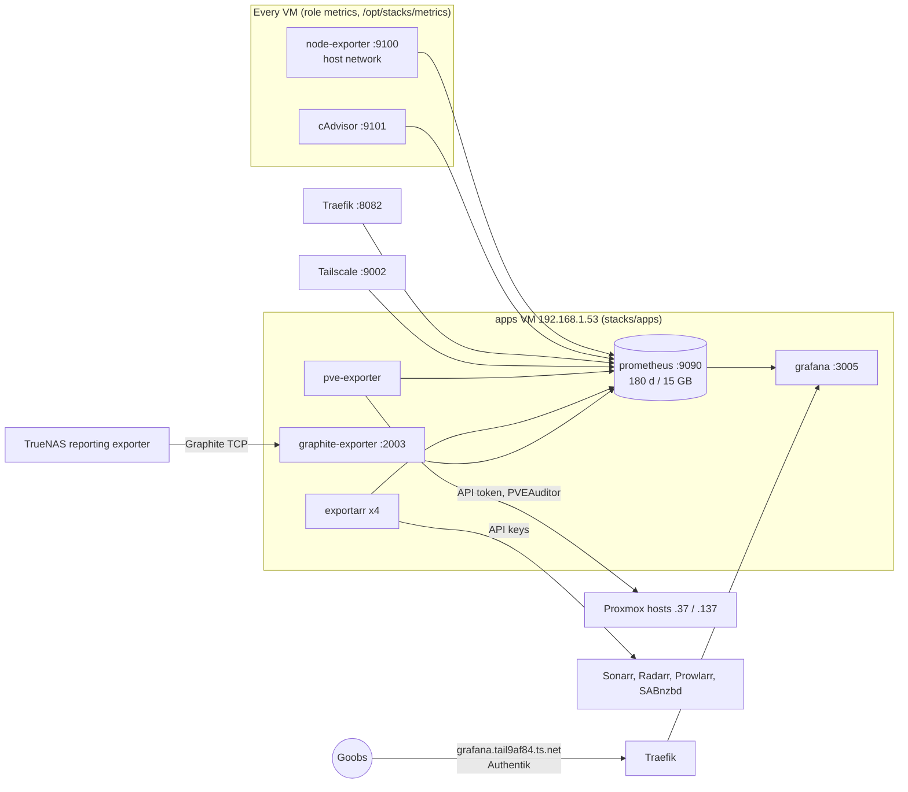

# Metrics and trend graphs (Prometheus + Grafana)

Added 2026-10-23. Kuma says whether something is up right now and the n8n digest says what went
wrong yesterday; Prometheus and Grafana answer "how has this been trending" (VM memory over a week,
NAS free space over months, which container eats the CPU, when SABnzbd was busy). **No alerts come
from here**: Grafana alerting is switched off so nothing duplicates the Kuma and n8n emails. If a
graph-based alert is ever wanted, the plan is to point Grafana at the n8n webhook, not at Gmail.



## Services

| Service | Where | Image | Notes |
| --- | --- | --- | --- |
| prometheus | apps, `:9090` | `prom/prometheus:v3.15.1` | 30 s scrape (cAdvisor 60 s, exportarr 2 min). Keeps 180 days or 15 GB, whichever is first. Data `/opt/appdata/prometheus` (excluded from the nightly tar: it is regenerable). 1 GB cap. |
| grafana | apps, `:3005` | `grafana/grafana:13.2.4` | `grafana.tail9af84.ts.net` behind Authentik. 512 MB cap. |
| pve-exporter | apps (no port) | `prompve/prometheus-pve-exporter:3.10.1` | Token `prometheus@pve!prometheus`, role PVEAuditor (read-only). RicksShip answers for the whole cluster. |
| exportarr-sonarr/radarr/prowlarr/sabnzbd | apps (no port) | `ghcr.io/onedr0p/exportarr:v2.3.0` | Reuse Homepage's read-only API keys. 128 MB cap each. |
| graphite-exporter | apps, `:2003` (TCP) | `prom/graphite-exporter:v0.17.0` | Receives TrueNAS's netdata metrics. Only 192.168.1.209 may send (`lanfw_extra_allow`). |
| node-exporter | every VM, `:9100` host network | `prom/node-exporter:v1.12.1` | CPU, memory, disks, NFS mount, network, systemd units. 64 MB cap. |
| cadvisor | every VM, `:9101` | `ghcr.io/google/cadvisor:v0.60.6` | Per-container CPU, memory, network, I/O, labelled with compose project and service. 192 MB cap. |

Traefik exposes `/metrics` on its own entrypoint `:8082`, and the Tailscale subnet router on `:9002`
(`TS_ENABLE_METRICS`). Scrape targets live in `stacks/apps/prometheus/prometheus.yml`.

## Login

Grafana trusts the `X-authentik-username` header (auth proxy), and only from 192.168.1.50: the port
is in the apps VM's `edge_only_ports`, so nothing but Traefik on the edge VM can reach it, the same
lock Open WebUI uses. The login form and sign-out are off. `akadmin` is the Grafana server admin;
any other Authentik user gets a Viewer account on first visit. `GRAFANA_ADMIN_PASSWORD` in the apps
secrets only exists because Grafana insists on one.

Prometheus's own UI (`prometheus.tail9af84.ts.net`, behind Authentik) is handy for ad hoc queries.

## Firewall

- Published ports (Prometheus 9090, cAdvisor 9101, Traefik 8082, graphite 2003) follow the usual
  DOCKER-USER rule: lab VMs only. Grafana 3005 is edge-only, graphite 2003 also accepts the NAS.
- node-exporter and Tailscale's metrics are host-networked, so DOCKER-USER does not see them.
  `lanfw` adds a small `LANFW-IN` chain at the top of `INPUT` that accepts those ports
  (`host_metrics_ports`) only from 192.168.1.53 and drops them from the rest of the LAN. Nothing else
  on `INPUT` is touched. Traffic arriving over the tailnet interface is not filtered by it.

## Dashboards

Provisioned from `stacks/apps/grafana/dashboards/Home lab/` (folder "Home lab"). They are read-only in
the UI; to change one, edit the file (or "Save as" a copy, export its JSON and commit it).

| Dashboard | Source |
| --- | --- |
| Home lab overview | `docs/gen_dashboards.py`: hosts, VMs, NAS free, top containers, Traefik |
| Media stack | `docs/gen_dashboards.py`: library and missing counts, queues, SABnzbd, Prowlarr, media containers |
| Node Exporter Full | grafana.com 1860 |
| cadvisor dashboard | grafana.com 19792 |
| Proxmox via Prometheus | grafana.com 10347 (pick instance 192.168.1.37 for the whole cluster) |
| Traefik Official Standalone | grafana.com 17346 |
| TrueNAS | `docs/gen_dashboards.py`: CPU, memory, ARC, per-disk I/O, network, NFS |

The TrueNAS dashboard (`docs/gen_dashboards.py`) reads `truenas_*` metrics: CPU, load, memory,
ARC, per-disk I/O and busy time, network and NFS. Pool free space comes from the VMs' NFS mount, since
the NAS reports no pool chart. Disk temperatures and SMART stay in Scrutiny.

## One-time setup

1. **Proxmox token** (once, on either host as root; the cluster shares users):

   ```sh
   pveum user add prometheus@pve --comment "Prometheus pve-exporter (read-only)"
   pveum acl modify / --users prometheus@pve --roles PVEAuditor
   pveum user token add prometheus@pve prometheus --privsep 0
   ```

   Put the token's value in `PVE_EXPORTER_TOKEN` and a random `GRAFANA_ADMIN_PASSWORD` in the apps
   secrets: `sops stacks/apps/secrets.sops.env`.
2. **TrueNAS exporter** (after the NAS is upgraded to 25.10; the screen moves between versions,
   so check the path there): Reporting > Exporters > Add: type GRAPHITE, destination
   192.168.1.53, port 2003, prefix `truenas`, namespace `nas`, update every 10 s.
3. Deploy (below), then run `docs/kuma_setup.py` for the Grafana and Prometheus monitors (digest only).

## Deploy

```sh
cd ~/HomeLab/homelab-infra/ansible
ansible-playbook playbooks/site.yml --tags lanfw,metrics   # firewall first, then the exporters on all five VMs
ansible-playbook playbooks/site.yml --limit apps --tags stacks
ansible-playbook playbooks/site.yml --limit edge --tags stacks   # Traefik metrics, Tailscale metrics, the two routes
```

Then, on the edge VM, `cd /opt/stacks/edge && sudo docker compose restart tsdproxy` so the two new
tailnet names (grafana, prometheus) register.

The edge deploy recreates the `tailscale` container (new environment), so the tailnet blips for a
few seconds; do it from the LAN. Check targets at `prometheus.tail9af84.ts.net/targets`.

## Sizing (2026-10-23)

About 25k series. Prometheus uses a few hundred MB of RAM and roughly 100 MB of disk a day, so 15 GB
is about five months; the time limit (180 d) or the size limit, whichever comes first, drops
the oldest blocks. The apps VM had 62 GB free and 5 GB RAM available before this.
